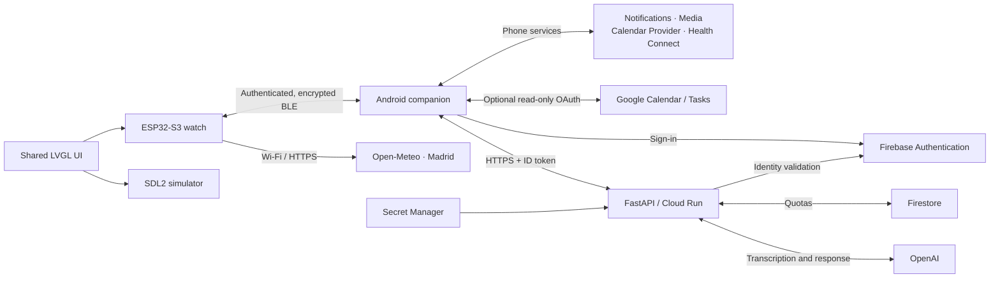

# ESP32 Smartwatch

**Experimental smartwatch with an ESP32-S3, AMOLED touchscreen, Android companion app, and voice AI assistant.**

Developed as a project which combines embedded firmware, an LVGL interface shared with a desktop simulator, secure Bluetooth Low Energy (BLE) communication, and external services for voice, weather, and calendar data.

Prototype development is complete. This document describes the delivered scope and its limitations: this is not a commercial product or a medical device. Successful builds and boot checks do not certify every feature or battery life.

## Contents

- [Overview and architecture](#overview-and-architecture)
- [Hardware and technologies](#hardware-and-technologies)
- [Prototype features](#prototype-features)
- [Mochi assistant](#mochi-assistant)
- [Repository structure](#repository-structure)
- [Building and getting started](#building-and-getting-started)
- [Security and privacy](#security-and-privacy)
- [Testing and validation](#testing-and-validation)
- [Limitations of the delivered scope](#limitations-of-the-delivered-scope)
- [Technical documentation](#technical-documentation)

## Overview and architecture

The system has three main components:

1. **Smartwatch:** runs ESP-IDF, renders the interface, captures speech, reads sensors, and manages local features.
2. **Android companion:** maintains the BLE connection, forwards notifications and media state, synchronizes activity/calendar data, and sends authenticated AI requests.
3. **Voice backend:** validates identity and quotas, requests transcription and responses from OpenAI, and returns text to the phone.



Weather is fetched **directly by the watch over Wi-Fi**, not through the phone. Voice and calendar features depend on the companion. Calendar data is not sent to the assistant or AI backend.

## Hardware and technologies

### Device

**Waveshare ESP32-S3 Touch AMOLED 2.06** board with a **410 × 502 pixel** display. The firmware integrates:

| Component | Purpose |
| --- | --- |
| ESP32-S3 | Firmware execution, BLE, and Wi-Fi |
| AMOLED and touch panel | LVGL interface and gestures |
| QMI8658 | Motion sensing, Motion Lab, and step detection |
| PCF85063 | Real-time clock |
| AXP2101 | Power/battery management and monitoring |
| ES7210 | Microphone capture |
| ES8311 and audio output | Speaker control and volume preview |
| PSRAM | Audio buffers and calendar caches/buffers |

The development unit detects **32 MB of flash**, while the firmware image is configured for **16 MB**. This is a known boot warning; the additional capacity is not used automatically. File recording to microSD is not included.

### Reference stack

| Component | Technology / configuration |
| --- | --- |
| Firmware | C/C++, ESP-IDF 6.1, and FreeRTOS |
| Interface | LVGL 9.5.0; Waveshare BSP 2.x |
| Simulator | CMake, SDL2, and the watch's shared C++ UI |
| Android | Kotlin, Jetpack Compose, Java/JDK 17; Android 13+ (API 33), compile/target SDK 36 |
| Mobile integration | BLE GATT, Health Connect, and Google Identity Services |
| Backend | Python, FastAPI, Uvicorn, Firebase Admin, and Firestore |
| Deployment | Google Cloud Run and Secret Manager |
| AI | `gpt-4o-mini-transcribe` and `gpt-4.1-mini` |

Exact dependencies are defined in the [ESP-IDF manifest](apps/watch/main/idf_component.yml), [Android Gradle configuration](apps/mobile/app/build.gradle.kts), and [backend requirements](apps/voice-backend/requirements.txt). This README does not replace those manifests.

## Prototype features

### Watch and interaction

- **Home:** time and date, Wi-Fi/NTP synchronization, connectivity and battery status; minimalist styling with a dotted clock.
- **Display and power:** brightness, screen timeout, Battery Saver, and persistent settings. Double-tap to wake; touches while the display is off must not trigger navigation. A one-second hold with the display off opens Mochi without starting a recording.
- **Settings:** Wi-Fi, Bluetooth, local speaker volume, microphone sensitivity, and hardware information. Watch volume does not change the phone's media volume.
- **Activity:** steps, daily goal, and weekly history; companion dashboard on Android and optional Health Connect export.
- **Tools:** timer, stopwatch, and Pomodoro with manually started focus/break phases.

### Applications

The launcher is arranged left to right, top to bottom:

| 1 | 2 | 3 |
| --- | --- | --- |
| **Weather** | Pomodoro | Motion Lab |
| **Media** | **Calendar** | 2048 |
| Sun & Moon | Planets | AI Assistant |

| Application / integration | Scope |
| --- | --- |
| Weather | Madrid weather from Open-Meteo, hourly and seven-day forecasts; daily highs/lows |
| Media | Phone playback state and controls, subject to permissions and an active media session |
| Calendar | Monthly grid with calendar/event colors, holidays, navigation, and a scrollable weekly agenda |
| Pomodoro | 25-minute focus, 5-minute break, and a 15-minute long break after four sessions |
| Motion Lab | Sensor motion visualization |
| Sun & Moon | Offline astronomical estimates for Madrid |
| Planets | Schematic orbits and approximate positions of eight planets |
| 2048 | Touch-controlled minigame with persistence |
| AI Assistant | Mochi: voice capture, processing states, and scrollable text responses |
| Notifications | Forwarding from Android through explicitly granted notification access |
| Health Connect | Optional export of watch steps; no general reading of health data |

### Calendar and tasks

The primary source is the **Android Calendar Provider**, with read-only permission and explicit calendar selection. Local sources with synchronization disabled are also listed and may contain cached data only.

- The default view is monthly; tapping **month/year** returns to the current month.
- Tapping a date opens its **entire week**, grouped Monday through Sunday in a vertically scrollable list, initially positioned at that day.
- Weekends and holidays have a very subtle gray background; event colors are preserved, while neighboring-month dates are dimmed.
- The **Last refresh** footer shows data age/status and allows a refresh retry.
- Up to six weeks are cached in RAM, with at most 32 events per week and an indication when data is limited.
- Times use **Europe/Madrid**; recurring events and all-day events with exclusive end dates are supported.

Optional **Google Calendar + Tasks** connectivity is implemented in the companion: it requires an Android OAuth client, enabled APIs, and separate account consent. It provides read-only selection of calendars, birthdays, and task lists. **Real synchronization is not considered validated until that configuration and authorization have been completed.**

Google Tasks exposes only the date through this API: pending dated tasks appear without an invented time; undated and completed tasks are not placed in the agenda. Avoid selecting both local and remote copies of the same source. See [Google setup](docs/google-agenda.md).

## Mochi assistant

### Voice flow

1. The user holds the recording control and speaks.
2. The watch captures **16 kHz mono PCM16**, up to **8 seconds**.
3. Audio is transferred to the phone over BLE, with session, sequence, length, and CRC checks.
4. Android checks authentication, backend authorization, and whether AI requests are enabled.
5. The backend validates the Firebase ID token, user allowlist, and quotas before calling OpenAI.
6. The transcription and response return to the watch as text. The user can scroll through the result or cancel the interaction.

Transcription is configured for Spanish, and responses default to **Spanish as spoken in Spain**, while respecting explicit requests for another response language. The watch interface remains in English. Spoken responses and continuous voice conversation are not included.

### Transport

Audio remains **PCM without lossy compression**. The notification variant uses **16-credit windows**, sending at most one packet per 10 ms callout, with capability negotiation, bounded buffers, expiration, and limited retries. The previous read-based mode (*legacy pull*) remains available as a compatible fallback.

Both notification transport and legacy mode have undergone physical checks; these do not constitute an A/B performance or battery-life benchmark. Build the development APK with **`-PvoiceNotify=true`** to enable notification transport: the Gradle file's default is `false`.

### Authentication and costs

The initial sign-in takes place on the phone. Automatic restoration uses a session encrypted with **AES-256-GCM and Android Keystore**, without storing passwords. The AI preference defaults to enabled, but requests are only admitted after authentication and access verification; manually disabling it persists across restarts.

> [!IMPORTANT]
> OpenAI calls may incur charges, independently of a ChatGPT subscription. Use `-PvoiceTransferOnly=true` to test transport only. Canceling an operation cannot reverse the cost of a request already accepted by a remote service.

## Repository structure

```text
.
├── apps/
│   ├── watch/                 # ESP-IDF firmware and board configuration
│   ├── watch-simulator/       # SDL2 simulator and host UI tests
│   ├── mobile/                # Android companion / Gradle
│   └── voice-backend/         # FastAPI service, tests, and deployment guides
├── components/
│   └── watch-ui/              # Shared LVGL UI and host logic/protocols
├── docs/                      # Design, protocols, features, and validation
├── tests/                     # Host, protocol, and activity tests and utilities
└── AGENTS.md                  # Local development and validation conventions
```

Entry points: [firmware](apps/watch/main/main.cpp), [shared UI](components/watch-ui/watch_ui.cpp), [Android](apps/mobile/app/src/main/java/dev/esp32/smartwatch/MainActivity.kt), [mobile BLE repository](apps/mobile/app/src/main/java/dev/esp32/smartwatch/ble/WatchRepository.kt), and [API](apps/voice-backend/app.py).

## Building and getting started

The following commands are for development. They do not provision infrastructure or make AI calls by themselves. Windows was used for firmware/simulator development; adapt paths and ports to your machine.

### Firmware

With **ESP-IDF 6.1** activated:

```bash
cd apps/watch
idf.py build
idf.py -p COM9 flash monitor
```

The target is **ESP32-S3**. `COM9` is the development port, not a requirement. Close the monitor when finished to release the port. Erasing flash is not necessary for a normal update.

Optional Wi-Fi configuration is loaded from `apps/watch/.env`, using `WIFI_SSID` and `WIFI_PASSWORD`, and incorporated into the build. Do not publish this file or distribute images containing personal credentials. ESP-IDF manages dependencies in `managed_components/`: do not make application changes there.

### Android companion

Requirements: **JDK 17**, Android SDK 36, an **Android 13 or later** phone, and Bluetooth LE. Open `apps/mobile` in Android Studio or run from that directory:

```powershell
.\gradlew.bat :app:assembleDebug :app:testDebugUnitTest -PvoiceNotify=true
adb install -r app/build/outputs/apk/debug/app-debug.apk
```

For transfer tests without voice API requests:

```powershell
.\gradlew.bat :app:assembleDebug -PvoiceNotify=true -PvoiceTransferOnly=true
```

Getting started:

1. Enable Bluetooth and grant the nearby-device permissions requested by the app.
2. Scan for **ESP32 Smartwatch**, connect, and complete secure pairing.
3. Allow notifications and special notification access only if you want forwarding. The companion uses a foreground service to maintain connectivity; Android battery restrictions may affect its continuity.
4. Configure Mochi through **AI Assistant · configure / sign in**, using the public Firebase Web API key and an authorized account. **Never enter an OpenAI key.**
5. Optionally enable calendar sharing, Google sources, and Health Connect step export, each with its own permissions and selections.

The public Firebase key can be entered on the phone or configured through the local file described in [apps/mobile/README.md](apps/mobile/README.md). It is not an OpenAI secret and does not grant authorization on its own. After uninstalling or clearing app data, permissions and sign-in must be repeated; connection changes may require forgetting the pairing on both devices.

### Desktop simulator

Requires CMake, **SDL2**, and, for the documented Windows setup, **Visual Studio 2019** and vcpkg. From the repository root:

```powershell
git submodule update --init --recursive
cd apps/watch-simulator
cmake -S . -B build -G "Visual Studio 16 2019" -A x64 `
  -DCMAKE_TOOLCHAIN_FILE=C:/path/to/vcpkg/scripts/buildsystems/vcpkg.cmake `
  -DVCPKG_TARGET_TRIPLET=x64-windows
cmake --build build --config Debug --target main watch_ui_tools_tests
.\bin\Debug\watch_ui_tools_tests.exe
.\bin\Debug\main.exe
```

Install `sdl2:x64-windows` through vcpkg first. The simulator uses the shared UI and mock data; **it does not emulate sensors, the BLE radio, audio, or real power management**. FreeRTOS simulation is not supported. See [its README](apps/watch-simulator/README.md) for details.

### Voice backend

The source is in `apps/voice-backend`. To prepare a local environment with a Python version compatible with its dependencies (Python 3.12 has been used):

```bash
cd apps/voice-backend
python -m venv .venv
# Activate .venv using the command appropriate for your system.
python -m pip install -r requirements-dev.txt
python -m pytest
```

Tests use mocked services and do not require OpenAI usage. Running the real API requires `OPENAI_API_KEY`, `FIREBASE_PROJECT_ID`, and `ALLOWED_FIREBASE_UIDS`; limits are controlled through `USER_DAILY_LIMIT` and `GLOBAL_DAILY_LIMIT`. Start the server with `python -m uvicorn app:app --host 127.0.0.1 --port 8080` only after privately preparing those dependencies and credentials.

The API exposes `POST /v1/voice` and `GET /healthz`. The latter only confirms process liveness, not that authentication, quotas, or OpenAI are working. The prototype has used Cloud Run in **Madrid (`europe-southwest1`)**; deploying another instance requires configuring the mobile endpoint and project services.

Backend guides include historical setup and deployment instructions: they must not be treated as verification of the current cloud state or executed automatically. See the [backend README](apps/voice-backend/README.md) and [update/deployment guide](apps/voice-backend/SPANISH_DEPLOY.md), reviewing existing resources, permissions, costs, and rollback before applying them.

## Security and privacy

- **BLE:** native bonding, authentication, and encryption for protected characteristics. It does not depend on a custom phone-admission filter.
- **Integrity:** CRC, session identifiers, offsets, and size/time limits; CRC detects corruption but does not replace encryption or authentication.
- **Voice:** OpenAI keys remain in the backend, supplied through Secret Manager; never in the firmware or APK.
- **Identity:** the backend checks Firebase tokens and an explicit user allowlist. The persistent mobile session is encrypted and excluded from backups.
- **Costs:** per-user and global quotas, input/output limits, concurrency controls, and consent tied to each recording. Canceling or disabling requests invalidates pending local work, without promising remote refunds.
- **Calendar:** explicit selection, read-only access, and a six-week RAM cache. Permission/selection changes and unpairing invalidate data; a disconnected watch may retain its cache until reconnection or reboot.
- **Google:** consent is separate from Mochi; Google Play services manages authorization. Tokens are not stored in app settings or transferred to the watch/backend.
- **Health Connect:** step-write permission only, with optional synchronization; records belong to this app, without impersonating a Wear OS provider.
- **Logs:** must not contain audio, transcriptions, responses, tokens, or credentials. Sensitive body/header logging must not be enabled.

> [!WARNING]
> Do not publish Wi-Fi passwords, OpenAI keys, tokens, service-account credentials, or private configuration files. Do not distribute APKs or firmware containing personal data. Hosting the backend in Madrid does not guarantee that all external providers process data in that region.

## Testing and validation

The repository includes tests for UI/navigation, dates and calendar data, voice transfer, activity, 2048, mobile authentication, permissions/quotas, and backend language policy. Distinguish **automated testing**, **physical checks**, and **performance measurements**.

| Area | Evidence and scope |
| --- | --- |
| Firmware | Recent successful builds and flashing to the watch through COM9 |
| UI/simulator | Successful builds and host suite, including the final launcher layout and calendar navigation |
| Android | Successful builds and unit tests; updates installed on the development phone |
| Physical boot | Bounded log captures showing touch, BLE, and weather initialization, with no observed hangs |
| Voice | Physical microphone → BLE → Android → backend → watch response flow checked during development; PCM/CRC transfer and legacy compatibility checked |
| Google Calendar/Tasks | Implementation and synthetic-data tests; real-account synchronization pending OAuth setup/consent |
| Interaction and battery life | Host suites do not certify physical contrast, step accuracy, every gesture, or battery life |

To check formatting from the repository root:

```bash
git diff --check
```

The historical legacy-transport baseline was **82,560 bytes / 2.58 s of audio**, approximately **30.09 s of BLE transfer** and **39.66 s until response assembly**, with a correct CRC. This is a single pre-optimization sample, **not current performance or a guarantee**. No percentage improvement is claimed without a comparable physical A/B test. The [latency](docs/voice-latency-profiling.md) and [BLE optimization](docs/voice-ble-window-optimization.md) notes preserve the context of those iterations; some describe states preceding the final deliverable.

## Limitations of the delivered scope

- The prototype targets this specific hardware and Android; no iOS companion is included.
- Weather, astronomy, and time-zone behavior are oriented toward **Madrid**; there is no global GPS-based location selection.
- The calendar is bounded, read-only, and phone-dependent; it does not replace a full calendar application. Google requires external setup and functional verification with the user's account.
- No file recorder is included: it was outside the delivered scope because no microSD was available. Temporary voice capture for Mochi is implemented.
- No spoken AI responses, continuous voice streaming, or ADPCM compression.
- Astronomical estimates and step counts are not intended for scientific, certified sports, or medical use.
- No statistical characterization of latency, power consumption, battery life, or long-term reliability has been completed; protocol simulations are not presented as measured speed improvements.
- Known warnings remain for detected versus configured flash size, BLE light-sleep restrictions, and LVGL development checks/deprecations.

These limitations define the delivered Master's Thesis scope; they are not promises of features for a future release.

## Technical documentation

The [retrospective SPEC catalogue](docs/specs/README.md) traces features from the
initial firmware to the delivered prototype, with requirements, acceptance scenarios,
source milestones and validation limitations. The [ADR catalogue](docs/adr/README.md)
records the implemented architectural decisions and their tradeoffs. These records
were reconstructed after implementation; they do not imply historical formal approval.

| Area | References |
| --- | --- |
| Voice and security | [Assistant](docs/watch-ai-voice-assistant.md), [BLE protocol](docs/ble-protocol.md), [latency](docs/voice-latency-profiling.md), [optimization](docs/voice-ble-window-optimization.md) |
| Calendar | [Calendar/agenda](docs/calendar.md), [Google Calendar and Tasks](docs/google-agenda.md) |
| Activity | [Watch](docs/watch-activity.md), [Android dashboard](docs/mobile-activity-dashboard.md), [Health Connect](docs/mobile-health-connect.md), [Motion Lab](docs/motion-lab.md) |
| Applications | [Weather](docs/weather-forecast.md), [Pomodoro](docs/pomodoro.md), [Sun & Moon](docs/sun-moon.md), [Planets](docs/planets.md), [2048](docs/watch-2048.md) |
| Interface and settings | [Design](docs/nothing-inspired-ui.md), [tools](docs/apps-settings-time-tools.md), [volume](docs/volume.md), [Battery Saver](docs/battery-saver.md) |
| Development | [Android](apps/mobile/README.md), [simulator](apps/watch-simulator/README.md), [backend](apps/voice-backend/README.md), [repository conventions](AGENTS.md) |

Manifests and source code determine the behavior of the compiled version. Technical notes preserve historical decisions and results; review their deployment instructions before reusing them.
