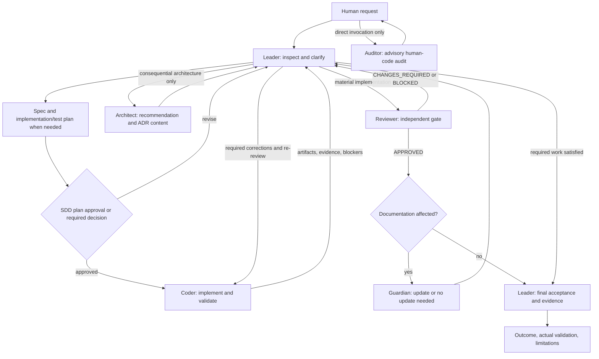

# OpenCode six-agent harness

This project provides a reusable OpenCode orchestration with six roles, a
Spec-Driven Development (SDD) command, independent implementation review, explicit
human approval gates, and a local role-boundary plugin. It assumes no application
language, framework, database, or deployment platform.

[AGENTS.md](../AGENTS.md) is the shared working contract. Agent definitions and
permissions are the source of truth for role-specific authority. This guide explains
how to use them; it does not grant additional permissions.

## Project layout

```text
AGENTS.md                       shared workflow and destination conventions
opencode.json                   default agent, permissions, Context7 configuration
package.json                    package metadata and verification script
.opencode/
  agents/
    leader.md
    architect.md
    coder.md
    reviewer.md
    guardian.md
    auditor.md
  commands/sdd-feature.md        explicit SDD workflow
  plugins/role-boundaries.js     role-boundary hook
  scripts/verify-harness.mjs     structural checks and optional native discovery
docs/
  agent-harness.md               this guide
  adr/TEMPLATE.md                generic architectural decision record
  specs/TEMPLATE.md              generic feature specification and execution record
```

### Relocated-layout alignment

The files now use a project-root layout rather than placing every file inside
`.opencode/`. Three existing references still assume the earlier layout:

| File | Current assumption | Alignment needed for this layout |
| --- | --- | --- |
| `opencode.json` | Explicit instructions point to `.opencode/AGENTS.md` | Use the root `AGENTS.md` location, or rely on its native discovery. |
| `package.json` | Verification script points to `scripts/verify-harness.mjs` | Point to `.opencode/scripts/verify-harness.mjs`. |
| `.opencode/scripts/verify-harness.mjs` | Configuration, instructions and agents are all under one directory that can be copied as `.opencode/` | Resolve project-root files and `.opencode/` assets separately, and preserve both when creating the temporary validation project. |

The installation paragraph in root `AGENTS.md` also describes the earlier
single-directory packaging. For the current layout, copy the project-root contents
shown above into the destination project root, merging existing configuration and
instructions deliberately. Copying only `.opencode/` omits root configuration and
the shared contract. These are observed relocation follow-ups, not completed fixes;
this documentation update does not change executable configuration or the verifier.

## Roles and ownership

| Agent | Responsibility | Write authority | Communication |
| --- | --- | --- | --- |
| Leader | Inspect, clarify, scope, plan, prepare specs, dispatch work, coordinate decisions, verify completion | Bounded documentation paths; implementation/configuration changes go to Coder | Only orchestrator; may delegate Architect, Coder, Reviewer, Guardian |
| Architect | Consequential boundaries, contracts, data/security flow, architectural recommendations and ADR decision content | Read-only | Returns recommendations and material questions to Leader |
| Coder | Approved implementation, tests, implementation configuration, migrations, explicitly requested harness changes | Delegated files and authorized operations | Returns artifacts, evidence, questions and blockers to Leader; no self-approval |
| Reviewer | Independent gate for material agent-generated implementation | Read-only | Returns a verdict and supported findings to Leader |
| Guardian | Maintain canonical documentation and record approved ADR content only when needed | Permitted documentation only | Returns to Leader when delegated; completes the documentation outcome when directly invoked |
| Auditor | Advisory audit of human-written changes | Read-only | Direct user invocation only, normally `@auditor`; no automatic dispatch or correction cycle |

Only invoke specialists when useful. Routine established patterns do not require
an Architect task. Small changes need no formal specification merely to satisfy a
template. A spec-only request ends at the specification. Material generated
implementation requires independent Reviewer assessment.

## Interaction model



Delegation uses OpenCode Task assignments and returned results. There is no separate
message service, persistent job queue, peer-to-peer dispatch, or automatic restart.
Leaf agents do not delegate. Leader centralizes consequential questions rather than
having each worker conduct a separate user interview.

### Handoff contract

Provide only material context, preserving decisions without copying entire transcripts:

```text
Directory and baseline: project/work directory; revision + dirty state, or file hashes
Outcome: accepted requirements and acceptance criteria
Scope: owned files, authorized operations, exclusions, concurrent ownership
Decisions: approved specification/plan, constraints, ADRs and approval references
Validation: required checks, prerequisites, acceptance mapping, current evidence
Pending: open questions, affected work, blockers and expected return contract
```

Assign disjoint file ownership before concurrent writes. Never duplicate assignments
or allow overlapping concurrent writers. Multi-repository work needs separate
revisions, dependency state, working directories and evidence per repository.

## SDD workflow

Invoke `/sdd-feature <feature request>` to use the explicit approval-based workflow
defined in [the command](../.opencode/commands/sdd-feature.md).

1. **Inspect and interview.** Read relevant code, conventions, tests, docs and specs.
   Ask only unresolved relevant questions about behavior, scope, constraints, edge
   cases, security/data contracts and acceptance. No edits during this phase.
2. **Prepare the specification.** Copy [the SDD template](specs/TEMPLATE.md) to
   `docs/specs/<feature-slug>/SPEC.md`, or update an existing canonical feature spec.
   Define normative requirements using EARS and stable requirement IDs. Link
   Given/When/Then acceptance scenarios to those requirements. Keep the implementation
   plan separate from behavioral requirements.
3. **Prepare the plan and tests.** Identify the smallest adequate approach, affected
   files, ownership, dependencies, required quality gates, documentation impact,
   risks and decisions. Map requirements and acceptance to planned checks.
4. **Obtain human approval.** Present scope, approach, files, tests, verification,
   documentation and open risks. Do not implement before approval. Record the actual
   approval and approved scope/revision rather than marking a draft approved by default.
5. **Implement and validate.** Coder follows approved scope and existing conventions,
   adds meaningful tests, runs authorized checks and returns current evidence.
6. **Independently review.** Reviewer assesses the diff, requirements, contracts,
   callers, tests, architecture and actual evidence. Required defects return through
   Leader to Coder for correction and then re-review.
7. **Document and complete.** Guardian updates materially affected knowledge and
   approved decisions where needed. Leader checks final acceptance, current required
   evidence, review and documentation before reporting the outcome.

Plan Mode is an instructional no-implementation phase, not an automatic agent or
permission switch. Spec preparation may write the spec before plan approval;
implementation must wait. Changing approved scope or SPEC requires renewed approval
before affected work continues. Ordinary clear requests retain proportional planning.

### EARS requirement convention

**EARS (Easy Approach to Requirements Syntax)** is the convention for normative
feature requirements within SDD specifications. Use one independently verifiable
obligation per requirement, stable IDs, explicit conditions, and observable responses.
The [specification template](specs/TEMPLATE.md) contains the applicable patterns:
ubiquitous, event-driven, state-driven, unwanted behavior, optional feature, and
combinations. Use only patterns needed by the feature.

For example:

- **R-001 — event-driven:** When a user submits an export request without an output
  limit, the system shall include all records matching the request.
- **R-002 — unwanted behavior:** If a submitted output limit is not a positive
  integer, then the system shall reject the export request with a validation error.

These examples illustrate syntax; actual behavior and bounds must be clarified and
approved for each feature. Derive Given/When/Then acceptance scenarios covering the
trigger, relevant states, boundaries, and observable outcome. Maintain the chain:

`EARS requirement -> acceptance scenario -> implementation artifact -> validation evidence`

EARS specifies required behavior. SDD still governs discovery, planning, approvals,
implementation and validation. Keep implementation tasks in the plan and architectural
decision rationale in ADRs; neither needs to be rewritten into EARS sentences.

## Architectural decision records

Use [the ADR template](adr/TEMPLATE.md) for consequential durable choices, not routine
local implementation details. Copy it to `docs/adr/<NNNN>-<decision-slug>.md`, using
the next available number. Link the feature spec and related decisions.

- Architect owns recommendation and decision content: context, drivers, realistic
  options, rationale, boundaries, consequences and migration/validation implications.
- Leader obtains required human decisions. A recommendation is not approval.
- Guardian records approved content and preserves history. It must not choose or
  silently supersede architecture; unresolved conflicts return
  `ARCHITECTURE_REVIEW_REQUIRED`.
- Start at Proposed. Record actual approval before Accepted. To change an accepted
  decision, create a new ADR with explicit supersession links instead of rewriting
  the historical rationale as though it had always been the decision.

## Testing and evidence

Discover tools and commands from destination instructions, manifests, lockfiles,
source and CI. No application test runner is assumed. Add useful tests for meaningful
behavior and regressions using existing frameworks, fixtures and public interfaces.
There is no universal test-first, blanket coverage expansion or trivial-edit test
mandate. Existing coverage gaps alone do not block unless acceptance requires them.

Read-only roles may run only exact permitted non-writing checks after inspecting
scripts and configuration. Tests/builds can write caches and artifacts: obtain
Coder evidence for those checks. Mock-based results establish only the simulated
contract, not live service or production integration.

Every executed check reports:

- Exact command and work directory.
- Exit status and relevant output or artifact reference.
- Checked artifact identity: revision **and** dirty-file state, or file hashes.
- Acceptance covered and any limitations or missing prerequisites.

Separate passed, failed, skipped, not run and pre-existing failures. Relevant edits
to code, tests, config, dependencies or environment invalidate affected checks;
rerun those checks. Do not turn planned validation or a worker's “done” into a pass.

## Review, recovery and human intervention

Reviewer returns one verdict:

| Verdict | Meaning | Next action |
| --- | --- | --- |
| `APPROVED` | No BLOCKER/MAJOR findings or missing required evidence | Continue toward completion; MINOR/NIT findings do not force a correction cycle |
| `CHANGES_REQUIRED` | Supported BLOCKER/MAJOR defects require correction | Coder fixes, reruns affected checks, and returns for independent re-review |
| `BLOCKED` | Required scope, context, evidence, environment or decision is unavailable | Leader obtains the prerequisite; no fabricated approval |

Findings need severity, location, failing scenario/evidence, consequence and practical
correction guidance. After two unsuccessful correction/re-review attempts, Leader
reassesses rather than looping blindly: Architect for design blockers, human for
material missing input. Stop only affected work and continue independent authorized
work. Never silently lower acceptance.

Guardian returns `UPDATED`, `NO_UPDATE_NEEDED`, `BLOCKED`, or
`ARCHITECTURE_REVIEW_REQUIRED`. Auditor returns advisory `CLEAN`, `ISSUES_FOUND`,
or `BLOCKED` directly to the user; its suggestions do not authorize implementation.

Human input is required for material ambiguity, consequential unresolved architecture,
accepted-decision conflicts, destructive operations, native permission prompts, and
the SDD approval gate. Reuse existing approvals for unchanged scope and ordinary local
choices. Installs, migrations, publishing, deployment, writing formatters and snapshot
updates retain their authorization requirements. Commit/push are denied by shipped
role permissions. Do not evade a denial through another command, tool or agent.

## Boundary plugin and native permissions

[The plugin](../.opencode/plugins/role-boundaries.js) supplements native permissions:

- Tracks the agent associated with each session and cleans up deleted sessions.
- Rejects shell calls until a known role is identified.
- Applies protected-path denies and sensitive-write approvals after Leader/Guardian
  documentation grants, including worktree-relative prefix handling outside Git.
- Requires read-only roles to have default-deny shell rules and exact simple allowed
  commands; rejects wildcard/operator grants and commit/push grants.
- Requires the whole requested read-only command to match its allowed entry and
  resolves the work directory to ensure it remains inside the project directory.
- Rejects patch moves for all roles; use separately permission-checked edits.

The default read-only grants are Git inspection commands. Configure destination
checks in native role frontmatter only after auditing side effects and configuration.
The plugin does not prove an arbitrary granted command non-writing or detect every
script change. Coder's broad native edit permission remains constrained by delegated
ownership; it is not a per-task filesystem sandbox. The overall boundary is a
cooperative tool safeguard, not an operating-system sandbox.

## Setup and optional configuration

After aligning the relocated references described above:

1. Copy/merge `.opencode/`, root `opencode.json`, `AGENTS.md`, and the desired `docs/`
   templates into the destination project. Review existing files before replacing
   anything. Package metadata is optional unless using its verification script.
2. Configure an available model/provider in OpenCode. Agent definitions inherit the
   configured model; optional `model` and supported `variant` frontmatter override
   individual roles. No particular provider is required.
3. Record repository-specific conventions in applicable instructions. Adjust bounded
   documentation grants and read guards if canonical locations differ. Add only
   inspected exact routine commands to per-role shell permissions.
4. Configure Context7 access if desired, inspect inherited settings, and restart
   OpenCode after configuration/agent/plugin changes.
5. Start in the destination project root and use Leader or `/sdd-feature <request>`.

No bundled skills are required. Recipient-added capabilities do not expand role
ownership or override human approvals. Inherited user/project configuration can
change effective permissions and must be inspected; keep the local plugin enabled
when relying on its safeguards.

### Context7

Context7 is the only configured MCP, at `https://mcp.context7.com/mcp`.
`CONTEXT7_API_KEY` is supplied through environment interpolation, not a committed
credential. When external version-specific documentation is needed, inspect local
versions first, resolve the relevant library ID, then issue focused queries. Keep
queries free of credentials and confidential source. Report material availability
limitations rather than inventing documentation results. A configuration entry is
not evidence of a live connection.

## Harness validation and current limitations

The verifier is intended to check role inventories/modes, permissions and delegation,
sensitive paths, instruction references, direct hook simulations and renamed-copy
portability. Its optional `--native` mode invokes installed configuration and agent
discovery without model execution; the temporary copy disables MCP connections.

The moved layout currently prevents a successful run: the verifier resolves
`opencode.json` under `.opencode/`, while the file now lives at the project root.
The package shortcut also points to a script path that no longer exists. Align those
paths and temporary-copy behavior before using either verification command as a gate.
Earlier validation results from the previous directory layout are historical and do
not establish that this moved tree passes.

This documentation update adds templates and guidance only. It does not qualify live
delegation, model availability, approval prompts, reviewer judgment, MCP connectivity,
or end-to-end orchestration. Report validation command, directory, exit/output and
checked artifact identity when those checks are performed.

## Example: generic command option

For `/sdd-feature Add an optional output limit to an existing command`:

1. Leader inspects existing configuration/command patterns and tests, then clarifies
   defaults, boundaries and invalid-input behavior.
2. The spec records R-001/AC-001 for unchanged default behavior, R-002/AC-002 for the
   configured limit, and an error scenario. The plan maps each to meaningful checks.
3. Existing patterns need no Architect task. If a consequential public contract is
   required, Architect recommends semantics and Leader obtains the human decision;
   Guardian records approved ADR content. The human approves the SDD plan.
4. Coder implements within assigned files and returns actual test evidence.
5. Reviewer independently challenges defects or missing evidence. Required corrections
   return through Leader to Coder, followed by affected checks and re-review.
6. Guardian updates command guidance if necessary. Leader verifies acceptance,
   current evidence, review and documentation, then reports outcome and limitations.
